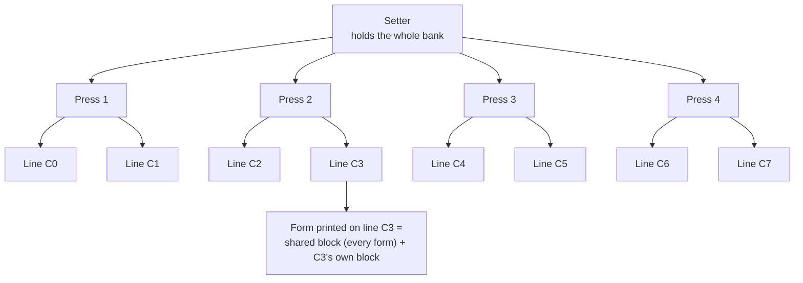
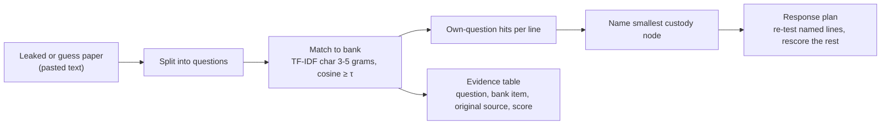

# Bulkhead

**Make any exam leak name its source, and re-test only the candidates it could have reached.**

> A QR code can be cropped and a canary's wording paraphrased. The questions cannot be dropped: they are
> what the leak sells. Bulkhead makes the questions themselves the tracer.

Track: Open Innovation · NovaStark Hacks 2026 · Team NovaNex

Live demo: `https://<your-project>.vercel.app` · Video: `/demo.mp4` on the live site · Results: [results/](results/)

---

## The problem

On 3 May 2026, 22.79 lakh candidates sat NEET-UG. A "guess paper" whose chemistry questions all matched the
real paper surfaced, the exam was cancelled, and it was held again on 21 June. NTA gave the CBI the names of
about 26 to 27 chemistry setters and translators and replaced every setter and translator for the re-exam.
In 2024 the Supreme Court refused a re-test because nothing on record showed the leak went beyond Patna and
Hazaribagh. In 2018, after a CBSE leak, experts noted that the board had once used different question sets
for different regions and had moved to one national set, so a leak anywhere now hits everyone.
(Sources, all opened: Kerala Kaumudi, 13 May 2026; Outlook India, 20 May 2026; Careers360/PTI, 7 Aug 2026;
Scroll, 23 Jul 2024; Careers360, 31 Mar 2018.)

Every centre receives the same questions, so a leaked copy cannot say where it escaped. Investigators start
from nothing, and the safe response is to cancel for everyone. QR codes and serial watermarks do not help:
a leak travels as a handwritten or retyped guess paper, and no mark survives that.

## The idea

Split the exam along its chain of custody, the way a ship is split into watertight compartments.



1. **Design.** Every form = a shared block + a block of questions that only one print line receives.
   Each press prints two lines; the setter holds everything.
2. **Decode.** Paste the leaked text, or photos of it (OCR runs in the browser). Each question is matched
   to the bank by character n-gram TF-IDF on two channels: the full text (cosine ≥ τ) and, for copies that
   lost their formulas, the words alone (cosine ≥ τ_words). Each threshold sits above every real
   calibration question that is not in the bank. A line counts as present when 3 or more of its own questions are found (raised automatically
   for very long papers so chance matches can never reach it). Bulkhead names the smallest custody node that
   covers every present line: a line, a press, the setter, several sources, or nobody. If nearly every match
   is one subject and it spans three or more presses, the leak came from that subject's setters and
   translators (the 2026 pattern): only that section is re-sat.
3. **Respond.** Re-test only the named lines. Everyone else keeps their result: drop the shared block
   (it may have leaked) and score them on their own block, which the leak does not contain. Compare scores
   by percentile within each line, as JEE Main already does for each shift.



**Truth comes from sets, not from AI.** The verdict depends only on which bank questions appear and on the
custody map. The matcher only adds speed. A weaker matcher can make Bulkhead say "not found" (today's
situation), but naming a wrong line would need several false matches in the same line.

## Results

Question text is **real**: 485 JEE Advanced questions (2016–2023) from JEEBench, after removing
near-duplicates. Leak copies are **simulated** from them with **assumed** copying noise. The demo exam
(60 questions per form, 8 lines, 4 presses) is **assumed**. Reproduce with `python3 eval/run_eval.py`.

τ = 0.576 (full text) and τ_words = 0.859 (words only), each set above every calibration decoy, clean and
noisy (`data/design.json`). On the 108 held-out decoys, read clean once and with noise 20 times (2,160 reads),
the false-match rate was 0 (`results/eval.json`, `matcher`). Recall on noisy bank questions: 0.999.

| Scenario (200 trials each) | Source named | Wrong line flagged | Re-tested | Leaked yet scored (worst) | Recall |
|---|---|---|---|---|---|
| Line leak: 75% of one form, 2:1 decoys | 1.000 | 0 | 12.5% | 0 | 0.998 |
| Press leak: both lines of one press | 1.000 | 0 | 25% | 0 | 1.000 |
| Small leak: 12 questions | 0.985 | 0 | 12.5% | 2 | 0.998 |
| Heavy noise: 20% character errors, 60% copied | 1.000 | 0 | 12.5% | 0 | 0.448 |
| Rewritten: 50% of words dropped, shuffled | 1.000 | 0 | 12.5% | 0 | 0.922 |
| Rewritten: 70% of words dropped, shuffled | 1.000 | 0 | 12.5% | 0 | 0.512 |
| Two leakers, different presses | 1.000 | 0 | 25% | 0 | 0.999 |
| Setter leak: master copy | 1.000 | 0 | 100% | 0 | 1.000 |
| Setter side: chemistry panel only | 1.000 | 0 | 100%, chemistry section only | 0 | 0.999 |
| Shared block only | 1.000 | 0 | 0% | 0 | 0.999 |
| Null: real decoys only | 1.000 | 0 | 0% | 0 | n/a |
| Null: rewritten decoys | 1.000 | 0 | 0% | 0 | n/a |
| Flood: line leak inside 1,080 decoys | 1.000 | 0 | 12.5% | 0 | 0.999 |
| Flood null: 1,080 decoys, no leak | 1.000 | 0 | 0% | 0 | n/a |

The 3 small-leak misses (of 200) named no line rather than a wrong one: the random 12 questions held only
1 or 2 of the line's own questions, below the 3 needed. Bulkhead still dropped the shared block for
everyone, so at most 2 leaked questions still counted toward that line's scores. "Wrong line flagged" is
0 in all 2,800 trials.

### Real OCR on page images

Every formula is deleted, the questions are rendered as pages in a handwriting-style font (Kalam) and in a
printed serif, with tilt, blur and grain, and read by Tesseract 5. Pages SYNTHETIC, OCR REAL.
Reproduce with `python3 eval/ocr_eval.py`.

| Font | Line leak | Press leak | 12-question leak | No leak |
|---|---|---|---|---|
| Handwriting style | named 3/3, recall 0.55 | named 3/3, recall 0.55 | named 3/3, recall 0.53 | nobody named 3/3 |
| Printed | named 3/3, recall 0.84 | named 3/3, recall 0.88 | named 3/3, recall 0.94 | nobody named 3/3 |

Even when only about half the leaked questions are recognised, the source is named: a line needs only 3 of
its 30 own questions.

### Against what exists

The six closest works, each opened and read (a wider list of eight directions is in
[docs/DIRECTIONS.md](docs/DIRECTIONS.md)):

| Closest work | How it traces a leak | Where it breaks on a 2026-style guess paper |
|---|---|---|
| Unique QR code or serial on every copy (CBSE since 2018; Telangana, 10 lakh codes per paper in 2025) | A photo or photocopy shows the code, which names the centre and the candidate | A retyped or handwritten copy carries no code; it never says who else must re-sit |
| Canary trap, or barium meal test (MI5; Tesla, 2008) | Each recipient gets different wording or facts; the leaked version names the recipient | A leaker who paraphrases, or compares copies, removes the bait; few remedies after the leak |
| Traitor tracing (Chor, Fiat, Naor and Pinkas, 1994) | A different key per customer; a leaked key names its owner | Fails when the decrypted content itself is passed on |
| Region-specific question sets (CBSE, earlier years) | A leaked set points to its region, so a re-test can stay in that region | Regions are not custody nodes; CBSE moved to one national set, and in 2018 the re-test scope rested on a police inquiry and was contested |
| Multi-shift papers with percentile scoring (JEE Main) | Each shift has its own paper; scores are compared by percentile within a shift | Shifts follow the clock, not custody: every press and centre handles every shift |
| Data forensics on multiple test forms (PSI) | A leaked document is matched to the identical test form; candidates who chose its wrong answers have scores invalidated | Names a form, not where in the supply chain it escaped; finds users only after their answers are in |

Matching a leak to a form is not new (PSI does it). Bulkhead's contribution is what the forms are: groups
keyed to the custody chain itself (line inside press inside setter), so the match names where the paper
escaped, and a response fixed in advance that bounds who re-sits. The tracer is the questions, which survive
retyping (tested) and copying by hand (tested only as a handwriting-style font read by OCR).

**Where QR codes win.** A photographed copy from one centre: a QR code names that centre, while Bulkhead names
its print line and re-tests 12.5%. The 2024 NEET leak was at single centres. Use both: the code for photos,
the questions for retyped copies, and more lines (16 lines: 6.25%) where finer blocks are worth the bank.

Run on the same simulated leaks (`python3 eval/baselines.py`, 50 trials per cell). Each cell: share of
candidates who re-sit / source named / custody nodes still suspected (of 13). Text copies only, so a QR code
answers exactly like one paper.

| Leak from | One paper (today) | + QR or serial per copy | 8 sets, every press prints all | Bulkhead |
|---|---|---|---|---|
| A print line | 100% / no / 13 | 100% / no / 13 | 12.5% / no / 9 | **12.5% / yes / 1** |
| A press | 100% / no / 13 | 100% / no / 13 | 100% / no / 5 | **25% / yes / 1** |
| The setter | 100% / no / 13 | 100% / no / 13 | 100% / no / 5 | 100% / yes / 1 |
| Chemistry setters only | 1 section / no / 13 | 1 section / no / 13 | 1 section / no / 5 | 1 section / yes / 1 |
| No leak | 2% / – / – | 0% | 0% | 0% |

Where Bulkhead does not help: a setter's full copy still means everyone re-sits, and a one-subject leak costs
one section under every design; Bulkhead only adds who to investigate. The 2% in the last row is one paper in
50 where a decoy matched a single bank question: a one-paper design treats any match as a leak, while Bulkhead
needs 3 of one line's own questions.

### Fairness of scoring on the own block (simulated)

After a line leak, everyone else is ranked on their line's own questions only, by percentile within the line.
`python3 eval/fairness.py` simulates 200,000 candidates (2PL item response model, own blocks deliberately
made easier or harder by up to ±0.4, candidates assigned to lines at random):

| Form | Rank agreement with true ability: whole paper | Own block, percentile in line | Own block, raw marks | True top 1% kept: whole / own |
|---|---|---|---|---|
| Demo (60 questions, 30 own) | 0.965 | 0.934 | 0.892 | 0.61 / 0.46 |
| NEET-sized (180, 90 own) | 0.988 | 0.976 | 0.917 | 0.76 / 0.66 |

The cost is real: at NEET size about one in ten of the true top 1% would swap places compared with a full
paper. That is the trade against re-examining 22 lakh candidates. Percentile scoring within the line is
essential (raw marks fall to 0.917), and candidates could be offered an optional re-sit. SIMULATED; it needs a
psychometrician's review.

### At NEET scale (derived, not measured)

180 questions per form, 8 lines, 90 own questions each: the bank needs 90 + 8 × 90 = **810 questions**
instead of 180. A line leak re-tests 12.5% of candidates; everyone else is scored on 90 questions the leak
never contained.

## Limits we know about

- **Bank cost.** 4.5× more questions to set and review. This is the price of the guarantee.
- **Fairness across blocks.** Own blocks differ in difficulty; percentile scoring within each line handles
  it the way JEE Main handles shifts. This needs a psychometrician's review before real use.
- **Rewriting.** Tested to 70% of words dropped and shuffled. A careful paraphrase or a translation into
  another language is not tested yet.
- **Simulated copies.** A test with real handwritten copies is planned: see `docs/REAL_COPY_PROTOCOL.md`.
- **Photos.** Photo input works (Tesseract.js in the browser), but only rendered fonts were tested. Real
  handwriting reads worse than the handwriting-style font, and formulas are lost; a handwriting OCR model
  is planned.
- **Speed.** About 0.6 s per 150-question paper in pure Python (measured in our workspace); 1.1 s for 310.
- **Setter leaks.** If the setter's full copy leaks, everyone re-sits, as today; Bulkhead only says it
  happened before printing. A one-subject setter leak costs one section, not the whole paper.
- **Names a node, not a person.** A named line or press starts an investigation. It is not a finding of guilt.

## Questions judges ask

**Isn't this the canary trap?** Same family. A canary's bait is wording, which a leaker can change. Bulkhead's
bait is the questions, which a leaker cannot drop without dropping what they sell. The canary only names a
culprit; Bulkhead also limits who re-sits.

**Boards already print QR codes.** They trace photos and photocopies. A retyped or handwritten guess paper
carries no code. Bulkhead reads the content.

**A WhatsApp leak spreads everywhere. Why re-test one line?** Spread does not matter; content does. A leak of
line C3's questions helps only candidates whose paper holds them, the candidates on line C3. Everyone else is
scored on questions the leak never held.

**What if the leaker rewrites the questions?** Named in all 200 trials with 70% of the words dropped and
shuffled, and in every OCR trial with all formulas removed. A careful paraphrase or a translation is not tested
yet.

**Can an insider frame another line?** Only by holding that line's questions, and only that line held them.
Framing needs access, and access is what Bulkhead names.

**Is it fair that lines answer different questions?** It is how JEE Main already runs shifts: percentile within
each group. In our simulation at NEET size, ranking on the 90 own questions agrees with true ability at 0.976,
against 0.988 for the whole paper; see the fairness table. A psychometrician should review it before real use.

**One centre leaked a photo. Isn't a QR code better?** Yes, for photos. Bulkhead is for the copies a QR code
cannot trace, and the two work together.

**Isn't matching a leak to a form already done?** Yes: PSI matches leaked documents to computer-test forms.
Bulkhead's contribution is forms keyed to the custody chain, so the match names where the paper escaped, plus
a bounded re-test fixed in advance.

**What does it cost?** For a NEET-sized form at eight lines, 810 questions instead of 180.

**What if the setter leaks?** Everyone re-sits, as today, but Bulkhead says the leak happened before printing,
and a one-subject leak points at that subject's setters and translators (the 2026 pattern).

**Why no LLM?** A verdict that sends investigators to a press must be repeatable and explainable line by line,
and the leaked paper should never leave the exam body's machines.

## Run it

No dependencies: Python 3.9+ standard library only.

```bash
python3 server.py                          # http://localhost:8000
python3 -m unittest discover -s tests      # 17 tests; parity test runs if scikit-learn is installed
python3 eval/run_eval.py --trials 200      # results table above (about 6 min with scikit-learn)
python3 eval/ocr_eval.py --trials 3        # OCR test on rendered pages (needs the tesseract binary)
python3 eval/baselines.py --trials 50      # today's designs vs Bulkhead on the same leaks
python3 eval/fairness.py                   # ranking cost of own-block scoring (needs numpy)
python3 scripts/export_form.py C3          # print one line's form, for the real-copy test
```

Rebuild the bank from source:

```bash
git clone https://github.com/dair-iitd/jeebench
python3 scripts/build_bank.py jeebench/data/dataset.json
```

Docker: `docker build -t bulkhead . && docker run -p 8000:8000 bulkhead`

Deploy: import the repo on Vercel (framework preset "Other"). `public/` is served as the site and
`api/*.py` become Python functions. No environment variables are needed.

## API

| Method | Path | Body or query | Returns |
|---|---|---|---|
| POST | `/api/decode` | `{"text": "..."}` | verdict, named nodes, hits per line, evidence, response plan |
| GET | `/api/sample` | `?kind=line&seed=1` | a simulated guess paper and its answer key |
| GET | `/api/design` | | compartments, presses, bank size, τ, presence rule |

Sample kinds: `line`, `press`, `small`, `heavy`, `rewrite70`, `two`, `setter`, `panel`, `shared`, `null`.
A sample photo (three pages) is in `public/samples/`.

## Security

- No accounts in the demo. Pasted text is processed in memory and never stored or logged by our code.
- Request caps: 400 KB per body, 300,000 characters, 1,500 questions.
- Vercel sends a strict Content-Security-Policy (same-origin only; WebAssembly allowed for OCR), `nosniff`,
  `no-referrer` and a locked Permissions-Policy. Fonts and the OCR engine are self-hosted.
- `data/design.json` holds a SHA-256 fingerprint of the bank and the custody map. The engine refuses to
  start if they do not match, so no question can be moved to another line after a leak. Publishing the
  fingerprint before the exam makes every verdict checkable.
- No outside AI API: the leaked text never leaves the function, and photos never leave the browser.
- PLANNED for production: run offline inside the exam body, role-based access, audit log.

## Repository

```
bulkhead/   engine: textsim (dependency-free TF-IDF), design, decoder, response, leaks, service
api/        Vercel Python functions
public/     the web app (HTML, CSS, JS; no build step), self-hosted fonts, Tesseract.js, sample photo
data/       bank.json (270 questions), decoys.json, design.json (τ and the presence rule)
scripts/    build_bank.py: rebuilds data/ from JEEBench
eval/       run_eval.py (main table), ocr_eval.py (OCR on page images), baselines.py, fairness.py
tests/      unit, end-to-end and scikit-learn parity tests
docs/       judges' notes, demo-video script, real-copy test protocol
```

Sources and AI use are listed in [DISCLOSURE.md](DISCLOSURE.md). Licence: MIT.
